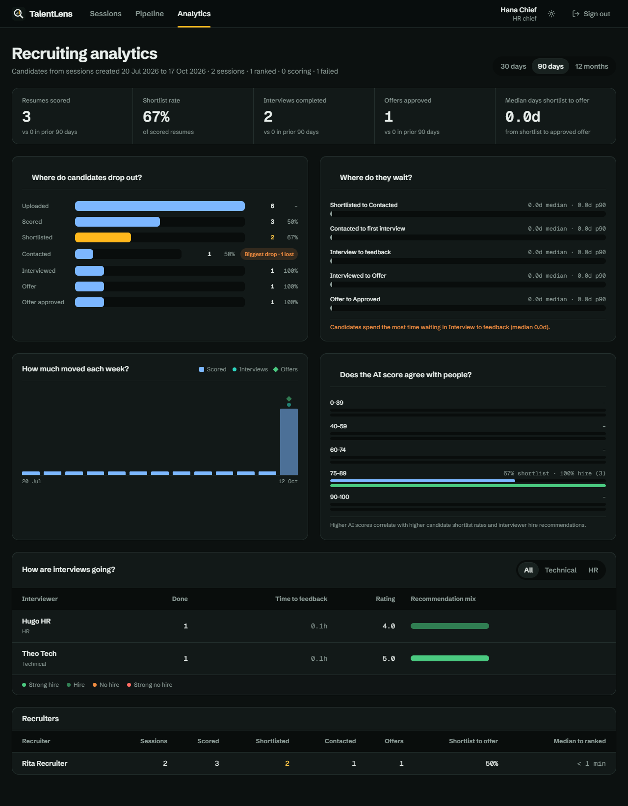
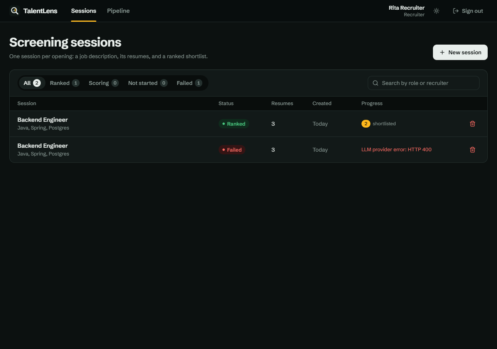
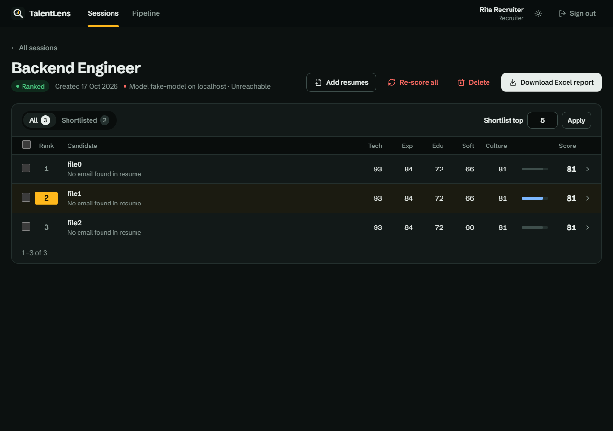
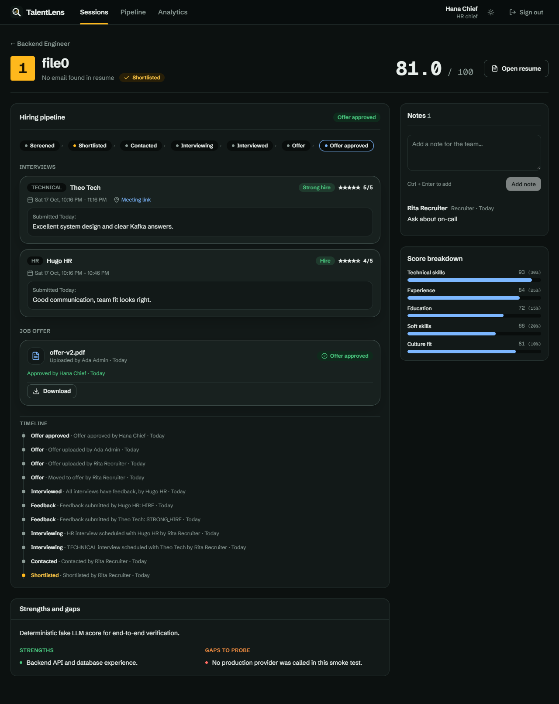
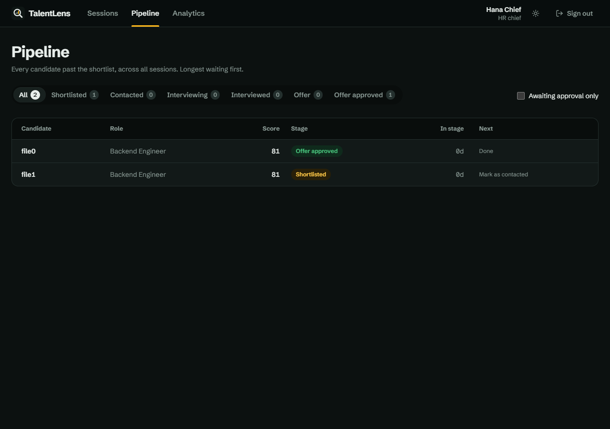
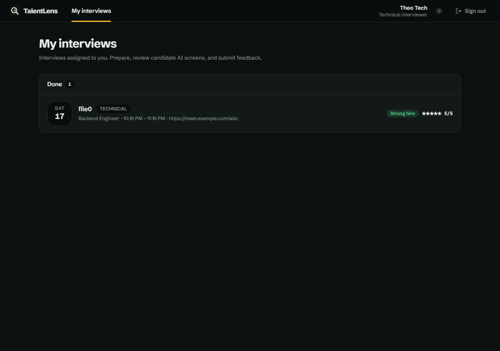
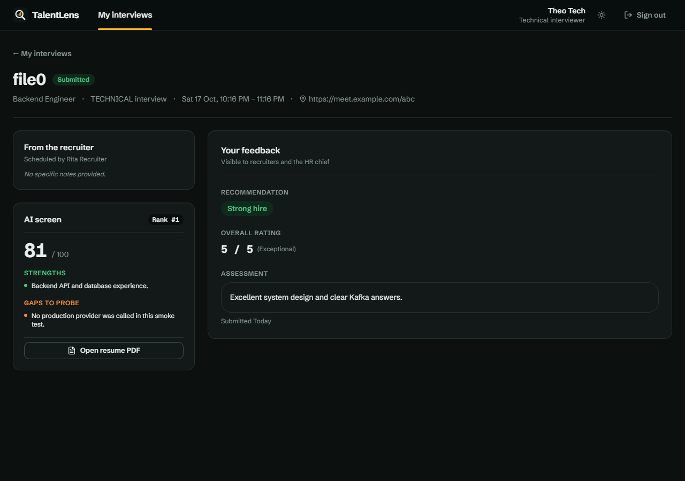

<p align="center">
  
</p>

<h1 align="center">TalentLens</h1>

<p align="center">
  <strong>AI resume screening and hiring pipeline for high-volume recruiting.</strong><br>
  Explainable, role-weighted LLM scoring, interviews and offers, and funnel analytics in one place.
</p>

<p align="center">
  <a href="https://github.com/MohSamer682/TalentLens/actions/workflows/ci.yml"></a>
  
  
  
  
  <a href="LICENSE"></a>
</p>

<picture>
  <source media="(prefers-color-scheme: light)" srcset="docs/screenshots/f8/analytics-light-1280.png">
  
</picture>

**TalentLens** helps hiring teams evaluate large applicant pools quickly, consistently and transparently, then carry the best candidates all the way to an approved offer. Recruiters open a screening session for a role, upload the job description and the resumes, and every candidate is scored against the role's own weighted criteria. Shortlisted candidates move through contact, technical and HR interviews, and an offer that an HR chief approves. Every step is recorded and measured.

It is built for high-volume hiring, where a single opening can attract hundreds of applications and reviewers need the same yardstick applied to every one of them.

**Stack:** Java 21 · Spring Boot 3 · React + TypeScript · PostgreSQL · MinIO (S3-compatible storage) · Docker. The scoring engine is provider-neutral and works with any OpenAI-compatible LLM (OpenAI, Gemini, DeepSeek, OpenRouter, Qwen, Kimi, Grok, ...).

## Screenshots

Every screen ships in dark and light themes; the images below follow your GitHub theme. More sizes, including 360 px phone views, are in [`docs/screenshots`](docs/screenshots).

| Screening sessions | Ranked session |
|---|---|
| <picture>   <source media="(prefers-color-scheme: light)" srcset="docs/screenshots/f5/dashboard-recruiter-light-1280.png">    </picture> | <picture>   <source media="(prefers-color-scheme: light)" srcset="docs/screenshots/f5/session-light-1280.png">    </picture> |
| **Candidate: scores, notes and stage timeline** | **Hiring pipeline** |
| <picture>   <source media="(prefers-color-scheme: light)" srcset="docs/screenshots/f7/candidate-light-1280.png">    </picture> | <picture>   <source media="(prefers-color-scheme: light)" srcset="docs/screenshots/f7/pipeline-light-1280.png">    </picture> |
| **My interviews (interviewer view)** | **Interview feedback** |
| <picture>   <source media="(prefers-color-scheme: light)" srcset="docs/screenshots/f7/my-interviews-light-1280.png">    </picture> | <picture>   <source media="(prefers-color-scheme: light)" srcset="docs/screenshots/f7/interview-feedback-light-1280.png">    </picture> |

## Key capabilities

| Capability | What it gives the recruiting team |
|---|---|
| **Role-specific weighted scoring** | Each session defines how much technical skills, experience, education, soft skills and culture fit matter (totalling 100), so the ranking reflects the role, not a generic template. |
| **Explainable results** | Every candidate gets five criterion scores, an overall score, a written justification, strengths, gaps and extracted skills. Reviewers see why someone ranked where they did. |
| **Shortlist and team notes** | Shortlist one candidate, a selection or the top N. Anyone who can open the session leaves notes on a candidate, so the team's reasoning sits next to the score. |
| **Hiring pipeline** | Shortlisted, Contacted, Interviewing, Interviewed, Offer, Offer approved. Recruiters schedule technical and HR interviews, upload the offer PDF, and a different person approves it. Every stage change is timestamped on a timeline. |
| **Interviewer roles** | Technical and HR interviewers see only the candidates assigned to them and submit a recommendation, a 1-5 rating and a written assessment once per interview. |
| **Funnel analytics** | KPIs against the previous period, where candidates drop out, median and p90 time in each stage, whether the AI score agrees with interviewers, and per-interviewer and per-recruiter tables. |
| **High-volume batch processing** | Resumes are processed asynchronously by a dedicated worker with live progress, cancellation and per-candidate failure isolation. Duplicates are skipped and only unscored resumes are re-run. |
| **Resilient AI integration** | Rate-limit aware, with automatic retries for provider throttling and malformed output, and request timeouts. One bad response never fails a whole batch. |
| **Provider independence** | Switch LLM vendor or model through configuration. No vendor lock-in. |
| **Reporting** | Ranked Excel export of every session for sharing with hiring managers. |
| **Access control and audit** | JWT authentication, admin-managed roles and permissions, and an audit trail of sensitive actions with request tracing. |
| **Secure document handling** | Resumes, job descriptions and offers live in object storage and are served through short-lived presigned links. |
| **Operable by design** | Versioned database migrations, structured JSON logging, health endpoints, containerized services and CI on every pull request. |

## Roles

| Role | What they do by default |
|---|---|
| **Admin** | Everything, plus users, roles and permissions, and the audit log. The first account registered becomes the admin. |
| **Recruiter** | Runs their own sessions, shortlists, contacts candidates, schedules interviews and prepares offers. |
| **HR chief** | Oversees every recruiter's sessions read-only, follows the pipeline, approves offers and reads analytics. Lands on **All sessions**. |
| **Technical / HR interviewer** | Sees only their own interviews and submits feedback. |

Admins can change what HR chiefs, recruiters and interviewers may do under **Roles and permissions**; managing users, roles and the audit log always stays with admins.
## How it works

```
 Browser ── React UI (nginx :3000)
              │  REST + JWT
              ▼
        api-service :8080 ──HTTP + shared secret──▶ batch-worker :8081
              │                                          │
              └────────── PostgreSQL + MinIO ◀───────────┘
```

1. A recruiter creates a **session** with five scoring weights that total 100: technical skills, experience, education, soft skills, culture fit.
2. They upload the **job description** and the **resume PDFs**. Files go to MinIO.
3. Starting the session tells the **batch worker** to process candidates one by one: extract the PDF text, ask the LLM for five 0-100 scores plus a justification, strengths and gaps, then compute the weighted composite score.
4. When all candidates are done, the worker ranks them and writes an **Excel report**. The UI shows progress while this runs.

The worker retries rate limits (HTTP 429) and malformed model output, waits behind a configurable requests-per-minute limit, and marks a single candidate as failed instead of failing the whole session.

## Modules

| Module | Stack | Purpose |
|---|---|---|
| `common/` | Java 21, JPA, Flyway | Entities, repositories, DTOs and the database migrations. Shared by both services. |
| `api-service/` | Spring Boot 3.3, Spring Security, JWT | REST API: auth, sessions, uploads, results, admin, audit log. |
| `batch-worker/` | Spring Boot 3.3, Resilience4j, PDFBox, Apache POI | PDF parsing, LLM scoring, ranking, Excel report. |
| `ui/` | React, TypeScript, Vite, Tailwind | Recruiter web app. |

Design decisions and known gaps: [docs/ARCHITECTURE.md](docs/ARCHITECTURE.md) and [docs/adr](docs/adr). Screenshots of every screen: [docs/screenshots](docs/screenshots).

## Quick start (Docker)

You need Docker with Compose and an API key for an OpenAI-compatible LLM provider.

```bash
cp .env.example .env     # then edit .env
docker compose up -d --build
```

Set at least these in `.env`:

| Variable | What to put |
|---|---|
| `LLM_API_KEY` | Your provider key |
| `LLM_BASE_URL` / `LLM_MODEL` | Provider endpoint and model (examples in `.env.example`) |
| `LLM_RATE_LIMIT_RPM` | Requests per minute your plan allows (free tiers are often 10-20) |
| `JWT_SECRET` | A long random base64 string |
| `BATCH_WORKER_SHARED_SECRET` | A long random string; the API and worker must share it |
| `POSTGRES_PASSWORD`, `MINIO_ROOT_PASSWORD` | Change from the example values |

Then open:

| Service | URL |
|---|---|
| Web app | http://localhost:3000 |
| API | http://localhost:8080 |
| MinIO console | http://localhost:9001 |
| Adminer (DB browser) | http://localhost:8085 |

The **first account you register becomes the admin**; later accounts are recruiters. Admins assign roles (recruiter, HR chief, technical or HR interviewer) on the Admin screen. To try the flow, use the fictional files in [`samples/`](samples) (`JD.pdf`, `Resume.pdf`).

## Local development

Run only the infrastructure in Docker and the apps on your machine:

```bash
docker compose up -d postgres minio
# load .env into your shell (Windows: set the same variables), then:

mvn clean verify                              # build and test all Java modules
mvn -pl api-service spring-boot:run           # terminal 1
mvn -pl batch-worker spring-boot:run          # terminal 2
cd ui && npm install && npm run dev           # terminal 3
```

`application.yml` defaults already point the database, MinIO and worker URL at `localhost`. Secrets (`JWT_SECRET`, `SPRING_DATASOURCE_PASSWORD`, `MINIO_ACCESS_KEY`/`MINIO_SECRET_KEY`, `BATCH_WORKER_SHARED_SECRET`, `LLM_*`) have no defaults and must be set.

Tests: `mvn verify` for the backend, `cd ui && npm test` for the frontend. CI builds both on every pull request.

## API overview

All endpoints except register and login need `Authorization: Bearer <token>`. Responses use one envelope with typed error codes.

| Method | Path | Purpose |
|---|---|---|
| POST | `/api/auth/register`, `/api/auth/login` | Create an account, get a JWT |
| POST, GET, PATCH, DELETE | `/api/sessions`, `/api/sessions/{id}` | Manage sessions and weights; the detail response includes the LLM status. `GET /api/sessions?everyone=true` lists every recruiter's sessions for roles that may open any session |
| POST | `/api/sessions/{id}/jd`, `/api/sessions/{id}/resumes` | Upload the job description; add resumes (PDFs or a ZIP of PDFs, up to 1000 per session). Duplicates are skipped and bad files reported per file |
| GET, DELETE | `/api/sessions/{id}/resumes?status=`, `/api/sessions/{id}/candidates/{candidateId}` | List a session's resumes with processing status and failure reason; remove one |
| POST | `/api/sessions/{id}/start?scope=UNSCORED\|ALL`, `/api/sessions/{id}/cancel` | Score unscored resumes (default) or re-score all; cancel scoring |
| GET | `/api/sessions/{id}/progress` | Live progress |
| GET | `/api/sessions/{id}/candidates`, `.../candidates/{candidateId}` | Ranked results and detail |
| GET | `/api/sessions/{id}/export` | Excel report |
| GET, POST, DELETE | `/api/sessions/{id}/candidates/{candidateId}/notes[/{noteId}]` | Notes on a candidate |
| PATCH, POST | `/api/sessions/{id}/candidates/{candidateId}/review`, `/api/sessions/{id}/shortlist/top` | Shortlist one, a selection, or the top N |
| GET | `/api/sessions/{id}/candidates/{candidateId}/timeline` | Every stage change with who and when |
| POST | `.../candidates/{candidateId}/contact`, `.../move-to-offer` | Move a candidate along the pipeline |
| GET, POST, PATCH, DELETE | `.../candidates/{candidateId}/interviews[/{interviewId}]` | Schedule, reschedule and cancel interviews |
| GET, POST | `/api/my-interviews`, `/api/interviews/{id}`, `/api/interviews/{id}/feedback` | The interviewer's own interviews and their feedback |
| GET, POST | `.../candidates/{candidateId}/offer`, `.../offer/download`, `.../offer/approve` | Upload, download and approve the offer PDF |
| GET | `/api/pipeline` | Every candidate past the shortlist, by stage |
| GET | `/api/auth/me` | The signed-in user with their current role and permissions |
| GET, PATCH | `/api/admin/users`, `/api/admin/users/{id}/role` | User management (admin only) |
| GET, PUT | `/api/admin/roles`, `/api/admin/roles/{role}/permissions` | What each role can do (admin only) |
| GET | `/api/admin/audit` | Audit log (admin only) |
| GET | `/api/analytics/overview?days=30\|90\|365` | Funnel analytics with the previous period for comparison (needs Analytics permission) |

The worker's `/internal/**` endpoints require the shared secret and are not for clients.

## Switching LLM provider

Only the base URL, model and key change:

| Provider | `LLM_BASE_URL` | Example `LLM_MODEL` |
|---|---|---|
| OpenAI | `https://api.openai.com/v1` | `gpt-4o` |
| OpenRouter | `https://openrouter.ai/api/v1` | any model id from their catalog |
| Gemini (compatible API) | `https://generativelanguage.googleapis.com/v1beta/openai` | `gemini-3.5-flash` |
| DeepSeek | `https://api.deepseek.com/v1` | `deepseek-chat` |

The model must be able to return JSON. The worker asks for `json_object` output and also extracts JSON from free-form replies, but a very small model can still produce unusable scores. The session page shows whether the configured model is reachable.

## Security notes

- No secrets are committed. `.env` is git-ignored and the apps refuse to start without their secrets.
- Passwords are hashed, every endpoint checks a permission granted to the caller's role, resumes are served through presigned URLs, and sensitive actions are written to an audit log.
- Postgres, MinIO and Adminer ports are published for local development. Do not expose them on a public host: remove their `ports:` entries or firewall them.
- `docker-compose.yml` uses `bitnamilegacy/minio` because the official MinIO images are no longer pullable from Docker Hub. It gets no security updates, so use a maintained S3-compatible store in production.
- Resumes contain personal data. Before real use, decide how long to keep files and scores and check your obligations (for example GDPR).

## Roadmap

Planned work, not yet implemented:

- Durable job queue so scoring scales across several worker instances
- Multi-tenant organizations with per-team data isolation
- Single sign-on (SAML / OIDC)
- Email and calendar invitations for scheduled interviews
- CSV export of analytics
- Integration with applicant tracking systems and email intake
- DOCX and image-based resume support
- Bias and fairness reporting for scored cohorts

## Known limitations

- Scoring jobs run in memory inside one worker instance. A worker restart marks running sessions as failed so they can be started again. A durable job queue is the next step for scaling out.
- Only PDF resumes are supported.
- LLM scores support a human reviewer; they are not a hiring decision. Models can be inconsistent and can reflect bias, so always read the justification.

## Contributing

Issues and pull requests are welcome. Open an issue first for larger changes, keep pull requests focused, and make sure `mvn verify` and `npm run build` pass. Commit messages follow [Conventional Commits](https://www.conventionalcommits.org/).

## License

[MIT](LICENSE)
