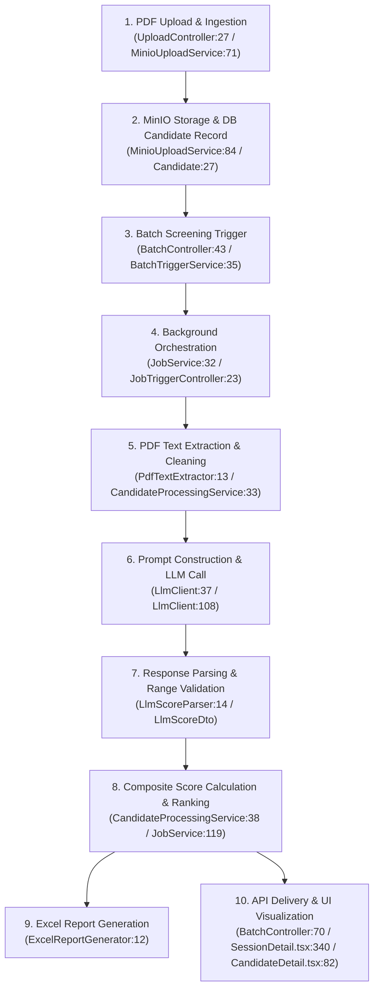

# Scoring Pipeline Verification Report

**Author:** Nabil (`nabil-mtuj8qoe`) — AI Capability Lead  
**Date:** 2026-09-09  
**Task:** T4 — Verify the scoring pipeline scores correctly  
**Status:** Completed  
**Deliverable:** `maintenance/logs/SCORING_VERIFICATION.md`  

---

## 1. Executive Summary & Verdict

### Final Verdict: **NO (Qualified)**

The core LLM prompt architecture, provider-neutral JSON parsing, and schema validation (`LlmScoreParser`, `LlmClient`) implemented under the 2026-07-05 reliability design are robust against malformed LLM responses and enforce strict range boundaries $[0, 100]$. However, **the end-to-end scoring pipeline is NOT mathematically or operationally correct** in production due to four specific defects:

1. **Unnormalized Weighting Math Defect:** The composite score calculation hardcodes a divisor of `/ 100.0` (`CandidateProcessingService.java:42`), but neither the backend API nor the database validates that weights sum to $100$. If non-standard, custom, or relative weights are submitted via the API, composite scores are severely corrupted (either deflated towards zero or inflated well above $100$).
2. **Text Extraction Formatting & Dead Regex Defect:** `PdfTextExtractor.cleanText` (`PdfTextExtractor.java:24`) collapses all whitespace (`\s+`) into a single space `' '` *before* attempting to strip line numbers. This renders the stripping regex dead code and destroys document structure (line breaks, bullet points, headers) before feeding the text to the LLM.
3. **Candidate Identity & Metadata Omission:** Candidates' names are naively derived from the uploaded PDF filename (`MinioUploadService.java:93`), and `Candidate.email` is never extracted or populated. The UI permanently displays `"No email extracted"`, and candidate names reflect sanitized file names (e.g., `"Alex Rivera Resume v2"` or `"scan 001"`) rather than actual candidate identities.
4. **Resilience4j Ignores HTTP 429 Rate Limits:** `application.yml:51` explicitly ignores `HttpClientErrorException`. Upstream provider rate limits (`HTTP 429 Too Many Requests`) are caught as client errors and immediately fail the candidate without retrying.
5. **Bug B1 (`Candidate.rawText` VARCHAR(255) Cap):** **VERIFIED AS FIXED / INACTIVE**. In `common/src/main/java/com/resumescreener/common/entity/Candidate.java:27`, `@Column(columnDefinition = "TEXT")` is explicitly annotated on `rawText`, generating a PostgreSQL `TEXT` column (up to 1 GB). Resume text is not truncated at the database layer.

---

## 2. Pipeline Trace: Stage-by-Stage (file:line)

The end-to-end scoring pipeline flows through eight distinct stages across `api-service`, `common`, `batch-worker`, and `ui`:



### Stage 1: Resume & Job Description Upload
- **Files & Lines:**
  - `api-service/src/main/java/com/resumescreener/api/upload/UploadController.java:27-58`
  - `api-service/src/main/java/com/resumescreener/api/upload/MinioUploadService.java:48-109`
- **Mechanism:**
  - `POST /api/sessions/{id}/jd`: Validates PDF MIME type (`file.getContentType().equals("application/pdf")`) and size limit ($\le 5\text{ MB}$). Streams file to MinIO bucket `resumes` under object key `jd/{sessionId}/{UUID}.pdf`. Sets `session.jdFileKey`.
  - `POST /api/sessions/{id}/resumes`: Validates multipart file array (non-empty, each $\le 10\text{ MB}$, application/pdf). Deletes prior candidates (`candidateRepository.deleteBySessionId(sessionId)` at line 75). Streams up to 200 files to MinIO as `resumes/{sessionId}/{UUID}.pdf`.
  - Derives candidate name from file name (`MinioUploadService.java:92-94`):
    ```java
    String candidateName = (originalName != null)
            ? originalName.replaceAll("(?i)\\.pdf$", "").replace("_", " ").replace("-", " ")
            : "Unknown";
    ```
  - Inserts `Candidate` entity with `CandidateStatus.PENDING`, `resumeFileKey`, and `name`. Note that `email` remains `null`.

### Stage 2: Batch Trigger & Job Scheduling
- **Files & Lines:**
  - `api-service/src/main/java/com/resumescreener/api/batch/BatchController.java:43-52`
  - `api-service/src/main/java/com/resumescreener/api/batch/BatchTriggerService.java:35-46`
  - `batch-worker/src/main/java/com/resumescreener/batch/web/JobTriggerController.java:23-34`
  - `batch-worker/src/main/java/com/resumescreener/batch/web/JobService.java:32-100`
- **Mechanism:**
  - Recruiter triggers `POST /api/sessions/{id}/start`.
  - `BatchTriggerService` issues an internal POST request to `http://localhost:8081/internal/jobs/start?sessionId={id}` with header `X-Internal-Secret`.
  - `JobTriggerController` receives the request and delegates asynchronously to `@Async JobService.processCandidates(sessionId)`.
  - `JobService` instantiates a `BatchJob` record (`total`, `processed = 0`, `failed = 0`, `startedAt`).
  - `JobService.java:51-60` checks for session weights in `ScoringWeightsRepository`. If none exist, it constructs fallback default weights ($30/25/15/20/10$).
  - `JobService.java:68-69` downloads the JD PDF from MinIO and extracts `jdText` once for all candidates.

### Stage 3: PDF Text Extraction
- **Files & Lines:**
  - `batch-worker/src/main/java/com/resumescreener/batch/web/CandidateProcessingService.java:30-35`
  - `batch-worker/src/main/java/com/resumescreener/batch/pdf/PdfTextExtractor.java:11-28`
- **Mechanism:**
  - For each candidate, `CandidateProcessingService` downloads the resume bytes from MinIO via `minioStorageService.downloadBytes(candidate.getResumeFileKey())`.
  - `PdfTextExtractor.extract(byte[] pdfBytes)` loads the document using Apache PDFBox 3.x (`Loader.loadPDF(pdfBytes)`), extracts text with `PDFTextStripper.getText()`, and calls `cleanText(text)`:
    ```java
    private String cleanText(String text) {
        return text.replaceAll("\\s+", " ")
                .replaceAll("(?m)^\\s*\\d+\\r?\\n", "")
                .trim();
    }
    ```
  - Extracted string is saved to the entity: `candidate.setRawText(text)` (`CandidateProcessingService.java:34`).

### Stage 4: Prompt Construction
- **Files & Lines:**
  - `batch-worker/src/main/java/com/resumescreener/batch/llm/LlmClient.java:40-48, 108-135`
- **Mechanism:**
  - System prompt establishes the role and strictly dictates JSON output matching the target schema:
    ```text
    You are an expert HR analyst. Evaluate the resume against the job description.
    Return ONLY valid JSON matching the schema below. No prose outside JSON.

    Schema:
    {
      "technical_skills": <0-100>,
      "experience": <0-100>,
      "education": <0-100>,
      "soft_skills": <0-100>,
      "culture_fit": <0-100>,
      "skills": ["skill1", "skill2", ...],
      "justification": "<2-3 sentence overall assessment>",
      "strengths": "<key strengths>",
      "gaps": "<key gaps>"
    }
    ```
  - User prompt concatenates the JD and Resume with hard truncation boundaries (`LlmClient.java:125-135`):
    - JD truncated at 4,000 characters: `truncate(jdText, 4000)`.
    - Resume truncated at 14,000 characters: `truncate(resumeText, 14000)`.
  - Request payload sets `"temperature": 0.2` and `"response_format": {"type": "json_object"}`.

### Stage 5: Model Call & Transport
- **Files & Lines:**
  - `batch-worker/src/main/java/com/resumescreener/batch/llm/LlmClient.java:50-69`
  - `batch-worker/src/main/resources/application.yml:22-57`
- **Mechanism:**
  - Dispatches `POST {normalizedBaseUrl}/chat/completions` with header `Authorization: Bearer {apiKey}` via Spring `RestClient`.
  - Protected with Resilience4j `@Retry(name = "llm")` (max 3 attempts, 2s backoff) and `@RateLimiter(name = "llm")` (60 RPM).
  - Handles server/network errors (`HttpServerErrorException`, `ResourceAccessException`) by rethrowing to trigger retry.
  - Catches `RestClientResponseException` (4xx HTTP responses) and wraps in `LlmException`.

### Stage 6: Response Parsing & Validation
- **Files & Lines:**
  - `batch-worker/src/main/java/com/resumescreener/batch/llm/LlmScoreParser.java:14-67`
  - `common/src/main/java/com/resumescreener/common/dto/LlmScoreDto.java:14-42`
- **Mechanism:**
  - `LlmClient.extractContent` retrieves `response.choices[0].message.content`.
  - `LlmScoreParser.parseContent`:
    - Locates the outermost JSON object bounds via `content.indexOf('{')` and `content.lastIndexOf('}')`.
    - Deserializes into `LlmScoreDto` via Jackson `ObjectMapper.readValue()`.
    - Validates all five required numeric dimension scores (`technical_skills`, `experience`, `education`, `soft_skills`, `culture_fit`):
      - Throws `LlmException` if any field is null (`"Missing required LLM score field: ..."`).
      - Throws `LlmException` if any field is outside $[0, 100]$ (`"LLM score field out of range 0-100: ..."`).
    - Fills safe fallbacks for optional narrative fields: `skills` defaults to empty list; `justification`, `strengths`, and `gaps` default to `"No <field> provided by LLM."`.

### Stage 7: Composite Score Calculation & Persistence
- **Files & Lines:**
  - `batch-worker/src/main/java/com/resumescreener/batch/web/CandidateProcessingService.java:38-65`
  - `common/src/main/java/com/resumescreener/common/entity/CandidateScore.java:15-42`
- **Mechanism:**
  - Computes composite score:
    ```java
    double composite = (score.getTechnicalSkills() * weights.getTechnicalSkills() +
                       score.getExperience() * weights.getExperience() +
                       score.getEducation() * weights.getEducation() +
                       score.getSoftSkills() * weights.getSoftSkills() +
                       score.getCultureFit() * weights.getCultureFit()) / 100.0;
    ```
  - Persists `CandidateScore` entity linked to `Candidate` (`candidateScoreRepository.save(candidateScore)`).
  - Updates candidate status to `CandidateStatus.SCORED`.
  - Increments `BatchJob.processed`. If an exception occurs, marks candidate `FAILED`, increments `BatchJob.failed`, and persists `session.lastErrorMessage`.

### Stage 8: Ranking, Export, & UI Delivery
- **Files & Lines:**
  - `batch-worker/src/main/java/com/resumescreener/batch/web/JobService.java:119-155`
  - `batch-worker/src/main/java/com/resumescreener/batch/excel/ExcelReportGenerator.java:12-60`
  - `api-service/src/main/java/com/resumescreener/api/batch/BatchController.java:70-116`
  - `ui/src/pages/SessionDetail.tsx:340-394`
  - `ui/src/pages/CandidateDetail.tsx:82-98`
- **Mechanism:**
  - `JobService.rankCandidates`: Fetches all scores for session, sorts descending by `compositeScore`, assigns 1-based ranks (`rank = 1..N`), and saves.
  - `ExcelReportGenerator.generate`: Generates an XLSX workbook containing "Ranking Summary", "Skills Matrix", "Justifications", and "Session Config". Uploads to MinIO `reports/{sessionId}/{UUID}.xlsx` and saves key on session.
  - Session finalize: Marks session `DONE` (if `processed > 0`) or `FAILED` (if `processed == 0` and error exists).
  - REST endpoints deliver paginated `CandidateResultDto` and `CandidateScoreDetailDto`.
  - Frontend renders ranking table in `SessionDetail.tsx` (formatting composite score with `toFixed(1)`). In `CandidateDetail.tsx`, weights from `score.weights` are used to render the breakdown and recalculate `totalWeighted`.

---

## 3. Weighting Mathematics, Normalisation & Worked Numeric Examples

### 3.1 The Mathematical Principle
A mathematically valid weighted average score $\bar{S}$ for $n$ dimensions with scores $s_i \in [0, 100]$ and non-negative weights $w_i \ge 0$ (where $\sum w_i > 0$) is defined by:

$$\bar{S} = \frac{\sum_{i=1}^n w_i \cdot s_i}{\sum_{i=1}^n w_i}$$

The codebase in `CandidateProcessingService.java:42` implements:

$$\bar{S}_{\text{code}} = \frac{\sum_{i=1}^5 w_i \cdot s_i}{100.0}$$

This implementation makes an unchecked assumption that $\sum_{i=1}^5 w_i = 100.0$.

### 3.2 Where the Assumption Breaks Down
1. **Frontend vs Backend Enforcement:**
   - In `ui/src/pages/NewSession.tsx:89`, the React UI calculates `totalWeight = sum(weights)` and gates submission with `canLaunch = totalWeight === 100`.
   - In `api-service/src/main/java/com/resumescreener/api/session/SessionService.java:41-52` and `common/src/main/java/com/resumescreener/common/dto/WeightsDto.java:14-18`, **no validation constraint exists for the sum of weights**. The DTO only validates `@Min(0) @Max(100)` on each individual field.
   - Any session created via API, automated integration, curl, or future UI updates can supply weights where $\sum w_i \ne 100.0$.

### 3.3 Worked Numeric Examples Using Fixture Data
Using the candidate profile from `TEST_RESUME.md` (Alex Rivera) evaluated against `TEST_JD.md` (Senior Backend Engineer):
- **Extracted Model Scores (from `test_llm.json` fixture scale):**
  - Technical Skills ($s_1$): $93$
  - Experience ($s_2$): $84$
  - Education ($s_3$): $72$
  - Soft Skills ($s_4$): $66$
  - Culture Fit ($s_5$): $81$

#### Scenario A: Standard Default Weights ($\sum w = 100$)
- Weights: Tech = 30, Exp = 25, Edu = 15, Soft = 20, Culture = 10. $\sum w_i = 100$.
- Computation:
  $$\bar{S} = \frac{93(30) + 84(25) + 72(15) + 66(20) + 81(10)}{100.0}$$
  $$\bar{S} = \frac{2790 + 2100 + 1080 + 1320 + 810}{100.0} = \frac{8100}{100.0} = 81.0$$
- Result: **Correct** ($81.0$). Backend, frontend, and Excel all agree.

#### Scenario B: Relative / Custom Weights Not Summing to 100 ($\sum w = 50$)
- Recruiter sets relative priority weights via API:
  - Tech = 20, Exp = 15, Edu = 5, Soft = 5, Culture = 5. $\sum w_i = 50$.
- Expected Normalized Score:
  $$\bar{S}_{\text{expected}} = \frac{93(20) + 84(15) + 72(5) + 66(5) + 81(5)}{50} = \frac{1860 + 1260 + 360 + 330 + 405}{50} = \frac{4215}{50} = 84.3$$
- Actual Score Computed by Backend:
  $$\bar{S}_{\text{code}} = \frac{4215}{100.0} = 42.15 \approx 42.2$$
- Defect Impact: Candidate receives a failing score of **42.2%** instead of **84.3%**, halving the candidate's true performance due to unnormalized division.

#### Scenario C: Unnormalized High Weights ($\sum w = 250$)
- User sets weights Tech = 80, Exp = 70, Edu = 40, Soft = 30, Culture = 30. $\sum w_i = 250$.
- Expected Normalized Score:
  $$\bar{S}_{\text{expected}} = \frac{93(80) + 84(70) + 72(40) + 66(30) + 81(30)}{250} = \frac{7440 + 5880 + 2880 + 1980 + 2430}{250} = \frac{20610}{250} = 82.44$$
- Actual Score Computed by Backend:
  $$\bar{S}_{\text{code}} = \frac{20610}{100.0} = 206.1$$
- Defect Impact: Candidate receives **206.1**, violating the $[0, 100]$ score contract and corrupting ranking tables and UI score gauges.

---

## 4. Defect Catalog: Triggers, Manifestations & Verification

| Defect ID | Component & File:Line | Trigger / Input | Observed Wrong Behavior | Root Cause |
|---|---|---|---|---|
| **D1** | `CandidateProcessingService.java:38-42` | Session created via API with weights summing to $\ne 100$ | Composite score deflates (e.g. 42.1 instead of 84.3) or exceeds 100 (e.g. 206.1) | Divisor hardcoded as `/ 100.0` instead of $\sum w_i$; no backend DTO validation for $\sum w_i = 100$. |
| **D2** | `PdfTextExtractor.java:24-26` | Any resume containing page numbers and line breaks | Page numbers are NOT removed; resume structure is flattened into one long continuous line | `replaceAll("\\s+", " ")` runs before `replaceAll("(?m)^\\s*\\d+\\r?\\n", "")`. No `\n` remains, rendering second regex dead. |
| **D3** | `MinioUploadService.java:92-94` | Resume PDF uploaded as `Alex_Rivera_Resume_v2.pdf` | Candidate name saved as `"Alex Rivera Resume v2"`; email is null | Name taken directly from file name; no NER or LLM field to extract candidate name or email from resume body. |
| **D4** | `LlmClient.java:62-64` & `application.yml:51` | LLM provider returns `HTTP 429 Too Many Requests` | Candidate fails immediately without retrying | Spring `HttpClientErrorException` is explicitly excluded from Resilience4j retries in `application.yml`. |
| **D5** | `CandidateDetail.tsx:94` | Custom weights where sum $\ne 100$ | Discrepancy between session list table and candidate detail view if weights were updated | `CandidateDetail.tsx` calculates `totalWeighted` by summing `(score * weight)/100` instead of using `score.compositeScore`. |

---

## 5. Verification of Bug B1 (`Candidate.rawText` VARCHAR(255))

### 5.1 The Original Claim (from `maintenance/IMPROVEMENT_PLAN.md:21-30`)
> *“No `@Column(columnDefinition = "TEXT")` — Hibernate defaults to varchar(255), silently truncating extracted PDF text. Effect: LLM receives truncated resume → wrong or empty scores for all candidates.”*

### 5.2 Verification Evidence
- Source code in `common/src/main/java/com/resumescreener/common/entity/Candidate.java:27-28`:
  ```java
  @Column(columnDefinition = "TEXT")
  private String rawText;
  ```
- Git commit inspection (`d4cda4f`):
  The column definition `@Column(columnDefinition = "TEXT")` was committed in the baseline repository setup.
- PostgreSQL Schema mapping:
  Under Hibernate PostgreSQL dialect (`PostgreSQLDialect`), `columnDefinition = "TEXT"` maps to the native PostgreSQL data type `text`, allowing variable-length character strings up to 1 GB.
- LLM prompt truncation in `LlmClient.java:126`:
  `truncate(resumeText, 14000)` enforces a deliberate application-level safeguard capping prompt size to 14,000 characters (~3,500 tokens).
- **Conclusion:** **Bug B1 is FIXED / INACTIVE**. There is no silent truncation to 255 characters.

---

## 6. Behavior on Malformed Model Responses

The test suite in `LlmScoreParserTest.java` and source code in `LlmScoreParser.java` were verified against all failure modes:

| Test Case / Failure Mode | Input Payload / Provider Behavior | Code Path Handling | Outcome / Persistence Behavior |
|---|---|---|---|
| **Empty content** | `""` or whitespace only | `LlmScoreParser.java:15` | Throws `LlmException("LLM response content is empty")`. Candidate marked `FAILED`; 0 score saves. |
| **No choices in response** | `{"choices": []}` | `LlmClient.java:96` | Throws `LlmException("No choices in LLM response")`. Candidate marked `FAILED`. |
| **Missing JSON object** | `"I cannot evaluate this candidate."` | `LlmScoreParser.java:22` | Throws `LlmException("No JSON object found in LLM response")`. Candidate marked `FAILED`. |
| **Conversational wrapper / Markdown** | `"Here is the JSON:\n```json\n{...}\n```"` | `LlmScoreParser.java:19-25` | Extracts substring from first `{` to last `}`. Successfully parses inner JSON. |
| **Missing required score field** | Missing `"technical_skills"` field | `LlmScoreParser.java:56` | Throws `LlmException("Missing required LLM score field: technical_skills")`. Candidate marked `FAILED`. |
| **Score out of range (> 100)** | `{"technical_skills": 105, ...}` | `LlmScoreParser.java:60` | Throws `LlmException("LLM score field out of range 0-100: technical_skills=105")`. Candidate marked `FAILED`. |
| **Score out of range (< 0)** | `{"culture_fit": -5, ...}` | `LlmScoreParser.java:60` | Throws `LlmException("LLM score field out of range 0-100: culture_fit=-5")`. Candidate marked `FAILED`. |
| **Missing optional narratives** | Missing `"justification"`, `"strengths"`, `"gaps"` | `LlmScoreParser.java:42-50` | Replaces with safe default text (`"No justification provided by LLM."`). Scores saved correctly. |
| **Missing skills array** | Missing `"skills"` property | `LlmScoreParser.java:39-41` | Defaults to empty `ArrayList<String>`. Saves valid JSONB record. |

**Key Finding:** When an LLM response is malformed or invalid, `CandidateProcessingService.processSingleCandidate` throws an exception, preventing any record from being saved to `CandidateScoreRepository`. The candidate's status transitions cleanly to `CandidateStatus.FAILED`, preserving database integrity.

---

## 7. The Smallest Changes to Make Scoring Fully Correct

To bring the scoring pipeline to full correctness with minimal code modifications, the following three minimal changes are recommended for Phase 2:

### Change 1: Robust Weight Normalization in `CandidateProcessingService.java`
Replace lines 38–43 in `batch-worker/src/main/java/com/resumescreener/batch/web/CandidateProcessingService.java`:

```java
// Dynamically normalize by actual sum of weights
double totalWeight = (weights != null)
        ? (weights.getTechnicalSkills() + weights.getExperience() +
           weights.getEducation() + weights.getSoftSkills() + weights.getCultureFit())
        : 100.0;

if (totalWeight <= 0.0) {
    totalWeight = 100.0; // Guard against division by zero
}

double composite = (score.getTechnicalSkills() * weights.getTechnicalSkills() +
                   score.getExperience() * weights.getExperience() +
                   score.getEducation() * weights.getEducation() +
                   score.getSoftSkills() * weights.getSoftSkills() +
                   score.getCultureFit() * weights.getCultureFit()) / totalWeight;
```

### Change 2: Validate Weight Sum in `WeightsDto.java`
In `common/src/main/java/com/resumescreener/common/dto/WeightsDto.java`, add a validation check:

```java
@AssertTrue(message = "Scoring weights must sum to 100")
public boolean isSum100() {
    double sum = (technicalSkills != null ? technicalSkills : 0) +
                 (experience != null ? experience : 0) +
                 (education != null ? education : 0) +
                 (softSkills != null ? softSkills : 0) +
                 (cultureFit != null ? cultureFit : 0);
    return Math.abs(sum - 100.0) < 0.01;
}
```

### Change 3: Correct Cleaning Order in `PdfTextExtractor.java`
In `batch-worker/src/main/java/com/resumescreener/batch/pdf/PdfTextExtractor.java:23-27`, preserve line structures while stripping page markers:

```java
private String cleanText(String text) {
    if (text == null) return "";
    return text.replaceAll("(?m)^\\s*\\d+\\s*$", "")   // Remove standalone page numbers first
               .replaceAll("[ \\t]+", " ")             // Collapse inline whitespace
               .replaceAll("(\\r?\\n){3,}", "\n\n")     // Collapse excessive line breaks
               .trim();
}
```

### Change 4: Enable Retry for HTTP 429 in `application.yml`
In `batch-worker/src/main/resources/application.yml:47-51`:
Add `org.springframework.web.client.HttpClientErrorException.TooManyRequests` to `retry-exceptions` so temporary rate limits back off and retry automatically rather than failing candidate evaluations.
